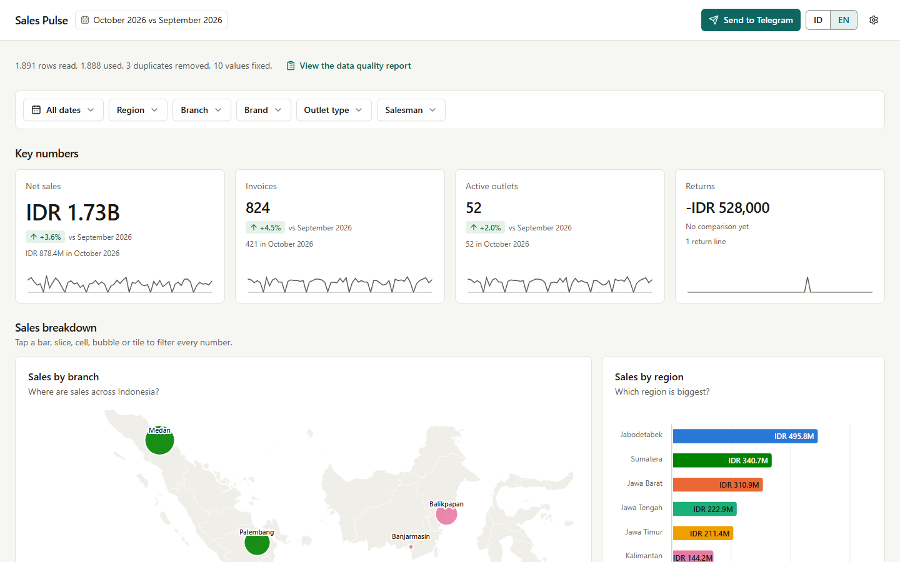
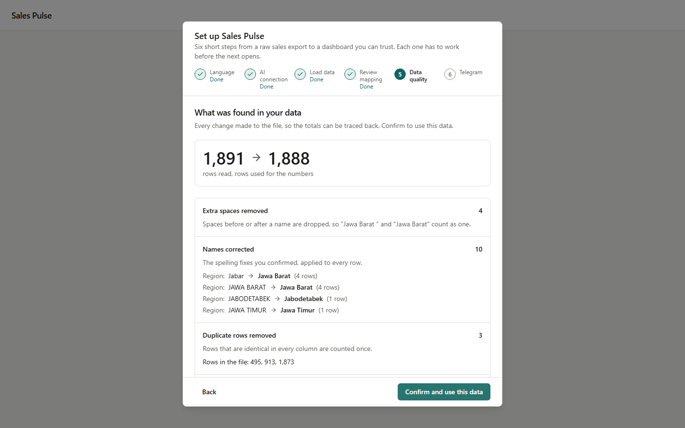
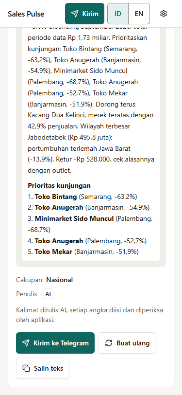

# Sales Pulse

Sales Pulse is a local web app for a **sales manager or head of region** who reads their numbers on a phone, in the field. You give it a messy sales export (a CSV from the ERP, any column order, Indonesian or English number formats, inconsistent spellings). It cleans the file with rules you can see and confirm, then shows **sales by region and brand** and **the 5 weakest outlets** (compared with outlets of the same type). It also writes **a one-paragraph summary in Bahasa Indonesia or English** and sends it to Telegram. Every number comes from code. The AI only writes the sentences around them.



| Data quality step (onboarding) | Telegram summary (375 px phone) |
|---|---|
|  |  |

---

## Requirements

- **Node.js 20 or newer** (`node -v`). `npm start` checks this and says so if not.
- **An LLM API key**: either an OpenAI-compatible endpoint (OpenAI, OpenRouter, Groq, a local server…) or Anthropic.
- **A Telegram bot and a chat ID.**

Without a key or a bot, use [demo mode](#demo-mode-no-keys-needed).

<details>
<summary><b>Get an LLM API key (3 steps)</b></summary>

1. **OpenAI:** sign in at <https://platform.openai.com>, open *API keys* → *Create new secret key*. **Anthropic:** sign in at <https://console.anthropic.com>, open *API keys* → *Create key*.
2. Make sure the account has credit (a test call costs a fraction of a cent).
3. In onboarding step 2, pick the format and keep the base URL that is filled in (`https://api.openai.com/v1` or `https://api.anthropic.com`). Paste the key, enter a model (e.g. `gpt-4o-mini`, or a current Claude model id), then press **Test connection**.
</details>

<details>
<summary><b>Create a Telegram bot and find your chat ID (3 steps)</b></summary>

1. In Telegram, open **@BotFather**, send `/newbot`, and answer the two questions. Copy the token it gives you (looks like `123456789:AA...`).
2. Open a chat with your new bot and press **Start**. For a team, add the bot to a group instead.
3. Send the bot any message, then open `https://api.telegram.org/bot<TOKEN>/getUpdates` in a browser. The number after `"chat":{"id":` is your chat ID (group IDs start with `-`).

The same guide is shown inline in onboarding step 6.
</details>

## Quick start

```bash
git clone https://github.com/Bargagana/sales-pulse.git
cd sales-pulse
npm install && npm start
```

Open **<http://127.0.0.1:5173>** (the URL is printed in the terminal). `npm start` builds the client and starts one Node process that serves the app and its API. Use `PORT=8080 npm start` to choose another port.

Measured on a fresh copy of this repo with an **empty npm cache**: `npm install` took 54 s (236 packages) and `npm start` answered 3.4 s later, so about 1 minute in all. That was on a Windows laptop; a Mac with a normal connection should be similar or faster.

Onboarding walks through 6 required steps: language → AI connection → load data (`data/data.csv` is the sample) → review mapping → data quality → Telegram. Everything can be changed later in ⚙️ Settings.

### Demo mode (no keys needed)

```bash
SALES_PULSE_LLM_MOCK=1 SALES_PULSE_TELEGRAM_MOCK=1 npm start
```

- The **mock AI** accepts any key and model. It proposes the mapping the built-in rules produce and writes a valid summary template.
- The **mock Telegram** accepts bot token `123:mock` and chat ID `42`. Any other value gets a "token rejected" error, so you can see the error handling.
- No network calls are made in demo mode.

Development with hot reload: `npm run dev` (API on 8787, Vite on 5173).

## How to use it

1. **Finish onboarding once** (6 steps above). With the sample file it takes about 3 minutes.
2. **Read the dashboard.** Key numbers on top, then sales by region (map and bar), brand by region, brand share, daily
   trend, top SKUs, and **5 weakest outlets** with the reason each one is listed.
3. **Filter by tapping.** Tap a region on the map, a bar or a brand to filter everything; tap again to release. The
   **Filters** panel adds dates, branch, outlet type, salesman, SKU and outlet. Active filters show as chips with
   **Clear all filters**.
4. **Compare periods** with the comparison-period control (needs two months of data).
5. **Send the summary.** **Summary for Telegram** shows the exact message; press **Send to Telegram**. The numbers in
   it come from code, the AI only writes the sentences.
6. **Load new data** from ⚙️ Settings, or let a scheduled job push the latest ERP export through the
   [Push API](#push-api).

---

## How the AI is used, and kept on a leash

The AI never touches a number. It does two narrow jobs, and code checks both.

**1. It proposes how to read the file. You confirm it, and code applies it.**
- What the AI sees: the header row, 5 sample rows, and the distinct values (with counts) of region, branch, outlet type, brand, SKU and salesman. It never sees the full dataset.
- What it returns: strict JSON, validated with zod. That JSON holds the column map, the date format, value fixes (`Jabar → Jawa Barat`) and coordinates for unknown branches. If the JSON is invalid it gets one retry with the validation error. After that, the app uses deterministic built-in rules instead, and says so.
- Onboarding shows every proposal: each column, each spelling fix with its row count, and each coordinate. You can edit or remove any of them before confirming.
- After you confirm, code applies the maps to every row. The same file and the same confirmed mapping always produce identical output. The confirmed mapping is saved and reused for later uploads and the push API.

**2. It writes the summary sentences, using placeholders only.**
- Code builds the facts (total net, MoM %, top/weakest region, top brand, the 5 weakest outlets, returns, period). The AI receives only their **keys and descriptions**, never their values.
- It returns one paragraph such as `Penjualan bersih {total_net} ({mom_pct} vs bulan lalu). Fokus kunjungan: {weak_1_name}…`.
- Code then checks the template. Every placeholder must exist, **no digit may appear outside a placeholder**, it must be one paragraph, and it must be ≤ 80 words after substitution. Only then does code put in the values, formatted for the locale (`Rp 1,73 miliar` / `IDR 1.73B`).
- If the check fails twice, a deterministic template is used and labelled "Standard template" in the UI.

## Data issues found in the sample (`data/data.csv`)

| Issue | What the app does | In the sample |
|---|---|---|
| Rows read → rows used | | **1,891 → 1,888** |
| Exact duplicate lines | Dropped and listed by row number | **3** (data rows 495, 913, 1,873) |
| Region spelling variants | Mapped to one name (AI proposes, you confirm) | **10 spellings → 6 regions**, 10 values fixed: `Jabar` (4) and `JAWA BARAT` (4) → Jawa Barat, `JABODETABEK` (1) → Jabodetabek, `JAWA TIMUR` (1) → Jawa Timur |
| Leading/trailing spaces | Trimmed | **4** values (`"Jawa Barat "`…) |
| Returns | Kept as negative sales (qty < 0 or invoice prefix `RTR`) | **1** line, RTR900001, **−Rp 528.000** |
| Different outlets with the same name | Outlets are grouped by `outlet_id`, never by name | **8** names, e.g. *Toko Anugerah* = OUT1024, OUT1041, OUT1045 |
| Missing salesman | Set to `Unassigned` | **5** rows |
| `qty × price ≠ gross`, `gross − discount ≠ net` | Flagged; `net_sales_idr` stays the source of truth | 0 |

The resulting totals are covered by tests. They are net **Rp 1.725.966.000** (gross 1.756.320.000, discount 30.354.000), 824 invoices and 52 outlets. September is **Rp 847.517.400** and October **Rp 878.448.600**, so MoM is **+3,65%**. Per-region and per-brand totals match PRD §8 AC2 exactly. They come out the same when the file has shuffled columns, renamed headers, a `;` delimiter, Indonesian number format, `DD/MM/YYYY` dates, or casing and spacing errors (`core/robustness.test.ts`).

## What "weakest outlet" means

A raw "lowest sales" list just names the smallest warungs. Instead, the app compares each outlet with **outlets of the same type**:

- **Periods:** the current month is the latest calendar month in the data, and the baseline is the month before it. If the current month is incomplete, days 1..D of both months are compared.
- **Eligible:** outlets with baseline sales > 0. An outlet with no sales this month counts as −100%. Outlets with no baseline (new ones) are excluded and listed.
- **Score** = the outlet's MoM % − the **median MoM % of its outlet type**. The 5 lowest scores are shown; ties go to the lower current sales.
- **Example:** Toko Bintang (OUT1022, Toko Kelontong) fell −63,2% while Toko Kelontong outlets grew +14,5% (median), so its score is −77,7. It ranks #1.
- Every row also shows the Rp change, because small baselines make % swings noisy.
- An alternative view, **Lowest vs peers** (outlet net ÷ median net of its type), is used automatically when the data has only one month.

## The sales map

The map colours each sales region as the provinces it covers, in the same colour as the region chart. A province belongs to:

1. the region named after it (`Jawa Barat`, `Jabar`, `DKI Jakarta`, ...);
2. otherwise the region whose branches are in it (the one with the most net sales there), found by placing each branch's coordinates on the province outlines. This is how `Jabodetabek` becomes DKI Jakarta + Banten;
3. otherwise a region named after its island (`Sumatera`, `Kalimantan`, `Sulawesi`, ...).

Provinces no region covers stay grey. Hover or tap an area for the region total and its branches; click it to filter. The legend under the map lists every region with its total, since not every label fits on Java.

## Push API

For automated loads, such as an agent pulling ERP data every morning. The token is shown in onboarding step 3 and in Settings → Data.

```bash
curl -X POST "http://127.0.0.1:5173/api/ingest?summary=true&lang=id" \
  -H "Authorization: Bearer <push token>" \
  -H "Content-Type: text/csv" \
  --data-binary @data/data.csv
```

The request parses the file, applies the saved mapping, cleans it, and replaces the dataset. **An open dashboard updates live** (server-sent events).

The saved mapping supplies the column and value fixes you confirmed. The date and number formats are detected again from each file, so the same export can arrive as `1641600` one day and `1.641.600` the next. The confirmed format only decides values the file cannot settle on its own, such as dates where every day is 12 or less.

Response (abridged, real output for the sample):

```json
{
  "datasetId": "ds_bdc4018fab474eea8e3c",
  "quality": { "rowsRead": 1891, "rowsClean": 1888, "duplicatesRemoved": 3, "duplicateRowNumbers": [495, 913, 1873],
               "returnLines": 1, "returnNet": -528000, "unmapped": [] },
  "periods": { "from": "2026-09-01", "to": "2026-10-31", "current": "2026-10", "baseline": "2026-09", "comparableDay": null },
  "kpis": { "netSales": 1725966000, "currentNet": 878448600, "baselineNet": 847517400, "momPct": 3.6496, "invoices": 824, "activeOutlets": 52 },
  "weakestOutlets": [
    { "outletId": "OUT1022", "name": "Toko Bintang", "outletType": "Toko Kelontong", "branch": "Semarang",
      "baseline": 8764300, "current": 3223100, "momPct": -63.22, "peerMedianPct": 14.45, "score": -77.68 }
  ],
  "summary": "Penjualan bersih Indonesia Oktober 2026 +3,6% dibanding September 2026, total periode data Rp 1,73 miliar. Prioritaskan kunjungan: Toko Bintang (Semarang, -63,2%), …",
  "summarySource": "llm"
}
```

- **Query parameters:** `summary=true`, `lang=id|en`, `region=<name>` (a region digest) and `telegram=true` (also sends the digest). The body can be raw CSV or `multipart/form-data` with a `file` field.
- **Errors:**

  | Status | When | Body includes |
  |---|---|---|
  | `401` | Wrong or missing token | |
  | `400` | Required columns missing | the columns |
  | `422` | Unknown region or brand values not in a confirmed mapping | the values; the old dataset is kept so you can review them in the app |
  | `422` | More than 5% of rows unreadable (`unreadable_rows`), which usually means a date or number format the mapping does not expect | the count and the first 20 unreadable cells; the old dataset is kept |
  | `400` | Malformed multipart body (`bad_multipart`) | |
  | `400` | Unknown `region` in the query | the valid regions |

- Unknown values in other columns (e.g. a new salesman) are loaded as `Unmapped`, and the dashboard shows a banner.

## Tests

```bash
npm test            # Vitest: core, server and client unit tests
npm run test:e2e    # builds, then Playwright: onboarding -> dashboard -> summary at 1440 px and 375 px, push API + live update
npm run test:all    # typecheck + both of the above
```

- **Core:** parsing, every cleaning rule, metrics, PRD golden values, 12 messy-input variants (AC3) and the summary validator.
- **Server:** the push API (auth, 400/422), credential encryption round trip, both LLM formats with recorded responses, the Telegram client (mocked HTTP), the Host/Origin guard, and a scan that no secret appears in any response or log line.
- **Client:** an i18n test that fails on a missing or empty key in either language, plus onboarding and dashboard component tests.
- **E2E:** full onboarding in both languages, the blocking gate, the push API (including format changes and keep-alive retries), phone layout and tap targets, and missing translations. It runs one production server per viewport (desktop 1440x900 on port 8804, phone 375x812 on port 5184) with the LLM and Telegram mocks and its own data folder under `.local-data/e2e/`.
- E2E needs the Playwright browser once: `npx playwright install chromium`.
- **Windows:** run Vitest from PowerShell or cmd. From Git Bash (a `/c/...` working directory) Node loads Vitest twice and every suite fails with "failed to find the current suite". `vite build` works from any shell.

## Security notes

- **Local only:** the server binds `127.0.0.1`, never your network interface.
- **Host and Origin checks:**
  - A request whose `Host` is not localhost gets 403. This blocks DNS-rebinding attacks.
  - A browser `POST`/`PUT` from another origin gets 403. This blocks CSRF.
  - The push API skips the Origin check and requires its bearer token instead, compared in constant time. A push refused before its body is read (wrong token, too large) also closes the connection, so a keep-alive client's retry starts clean.
- **Browser hardening:** every response carries a Content-Security-Policy (`script-src 'self'`, `connect-src 'self'`, `frame-ancestors 'none'`), `X-Frame-Options: DENY` and `Referrer-Policy: no-referrer`. Other sites cannot frame the app to trick a click on *Send to Telegram* or *Forget credentials*, and injected script could not send data to another host. Names from the data (brands, regions, outlets) are rendered as text and never as HTML, and the mapping step rejects AI-proposed names that contain `<` or `>`.
- **Credentials:** the API key, bot token and push token are entered in the UI and sent once to the local server. They are never returned to the browser (masked in Settings) and never logged.
  - They are stored with **AES-256-GCM** in the OS user data folder: `~/Library/Application Support/sales-pulse/` on macOS, `%APPDATA%\sales-pulse` on Windows, `~/.config/sales-pulse` on Linux. The key is a random 32-byte file with mode `0600` in the same folder.
  - Settings → *Forget credentials* deletes both files. That also invalidates the push token; a new one is created on next use.
  - The data folder can be overridden with `SALES_PULSE_DATA_DIR`.
- **Honest limits:**
  - This keeps secrets out of the repo, logs, browser and API responses. It does **not** protect against someone (or malware) running as your user account: the key file sits next to the encrypted file.
  - Any local process can also read the push token from `GET /api/push-token`. Other websites cannot, because the browser's CORS rules stop them.
  - Provider error texts are replaced by our own messages, because some providers echo the API key back.

## Highcharts licence

The Indonesia map uses **Highcharts Maps**. It is free for **non-commercial** use (personal, school, non-profit, evaluation). **Commercial use, such as running this inside a company, needs a paid Highcharts licence.** The credit is left visible on purpose, as plain text (a link would be a too-small tap target on a phone). The map is isolated in one lazily loaded component (`client/src/features/dashboard/charts/BranchMap.tsx`), so it can be swapped for e.g. react-simple-maps or Leaflet without touching the rest. All other charts use ApexCharts (MIT).

## Limitations

- **Single user, single machine, one active dataset.** No hosting and no accounts.
- **Size:** tested up to about **100k rows** (parse and clean about 3 s, metrics under 1 s). Above that, the browser-side cross-filtering would need a server-side aggregate API.
- **Uploads awaiting mapping are kept in memory** (max 5, 1 hour). After a server restart mid-onboarding, pick the file again.
- **Push API:** only region and brand values block a push (422). Other new values load as `Unmapped` with a banner. Up to 5% unreadable rows are dropped and listed in `quality.unparseable`; more than that refuses the push.
- **LLM base URL:** the server calls whatever http(s) URL you enter, including addresses on your own network. Only you (or a process on your machine) can set it, and the response body is never shown, but do not point it at internal services.
- **Notes stay in English:** the AI's free-text notes and validation details appear under "Technical notes", untranslated. Every headline and message around them is translated.
- **Map:** six region colours cannot all be told apart by colour-blind readers. The map therefore also uses branch labels, a tooltip and the region bar next to it.
- **Live AI and Telegram:** a real OpenAI 401 and a real Telegram "unauthorized" were checked. A full successful run against a live model and bot depends on your keys; CI uses recorded responses and the built-in mocks.
- **Partial months:** dates in the sample are complete months. A partial current month is handled (day 1..D), but only unit-tested.

## Next steps

1. **Scheduled digests:** a morning Telegram or **Microsoft Teams** message per region head, with the same facts and validator.
2. **Per-region digests and recipients:** one chat per Head of Region, scoped automatically.
3. **QAD ERP connector:** pull the export directly (or via an agent that calls the push API), instead of a CSV.
4. **History:** keep each pushed dataset so trends span more than two months.
5. **Minimum-baseline option** for the weakest-outlet ranking (e.g. ≥ Rp 1 juta), so tiny outlets with noisy % swings can be filtered.

## Project layout

```
core/     Pure TypeScript: parse, map, clean, metrics, summary validation. Runs in Node and the browser.
server/   Hono on Node: LLM adapters (OpenAI-compatible, Anthropic), Telegram, push API, SSE, encrypted store.
client/   React 19 + Vite, Tailwind v4 + shadcn/ui, ApexCharts, Highcharts Maps, react-i18next (id/en).
e2e/      Playwright: onboarding, dashboard, push API, accuracy against an independent oracle, exploratory cases.
data/     Sample CSV.
```

Specs: [PRD.md](PRD.md) (requirements and golden numbers), [CONTRACTS.md](CONTRACTS.md) (module contracts and HTTP API), [DESIGN.md](DESIGN.md) (design system).

## Related projects

Three small tools by the same author. Each runs on its own; together they show one loop: a business app, a scheduled
agent, and a monitor that keeps both running.

| Project | Problem it solves | Port |
|---|---|---|
| [Sales Pulse](https://github.com/Bargagana/sales-pulse) | Turns a messy ERP sales export into a phone-friendly dashboard (sales by region and brand, 5 weakest outlets) and a Telegram summary for the sales manager. | 5173 |
| [Rekon](https://github.com/Bargagana/rekon) | Matches bank transfers to open invoices automatically when certain, and sends only the ambiguous ones to the AR clerk. | 5174 |
| [Jaga](https://github.com/Bargagana/jaga) | Watches apps, scheduled jobs and business metrics, alerts Telegram/Teams once per real incident, and serves a status page. | 5175 |

To run all three on one machine, run `npm install && npm start` in each folder. Jaga's default config already watches
the other two. Jaga prints a heartbeat URL and a metric URL on first start; start Rekon with them so its daily job
reports in:

```bash
JAGA_HEARTBEAT_URL=http://127.0.0.1:5175/ping/<token> JAGA_METRIC_URL=http://127.0.0.1:5175/metric/<token> npm start
```
